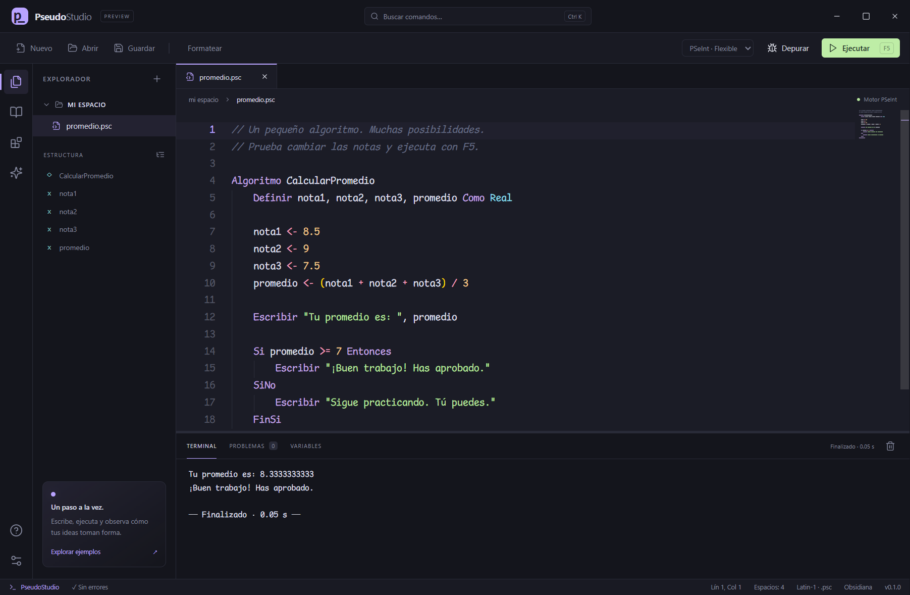
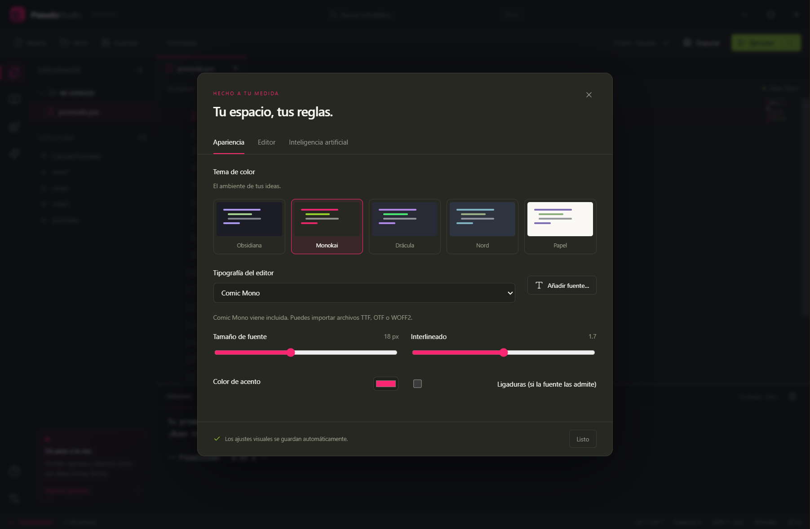

# PseudoStudio

Un IDE de pseudocódigo para Windows con el **motor real de PSeInt**, un editor moderno y personalización visual.

<p align="center"></p>

**Versión 0.3.0 · preview · Windows x64.** Proyecto independiente, sin afiliación oficial con PSeInt.





## Usar la aplicación

Extrae **todo** `PseudoStudio-0.3.0-Windows-x64.zip` en una carpeta permanente y abre `PseudoStudio.exe` dentro de ella. Conserva `resources` y el resto de archivos junto al ejecutable. No necesita instalar Node.js, PSeInt ni un compilador y no vuelve a extraerse al abrir. El acceso directo entregado ya apunta a esa carpeta permanente.

1. Edita el ejemplo inicial o abre un archivo `.psc`.
2. Presiona **F5** para ejecutar. Cuando el algoritmo use `Leer`, introduce el valor en la terminal.
3. Presiona **F6** para depurar y **F10** para avanzar. La pestaña Variables muestra las variables declaradas con `Definir`.
4. Abre Ajustes con **Ctrl+,** para elegir un tema, una fuente y las opciones del editor.

El ejecutable no está firmado con un certificado comercial. No modifica asociaciones de archivos ni instala componentes en el sistema. Ajustes, borradores, fuentes importadas y extensiones del usuario se guardan en la carpeta `userData` de Electron bajo `%APPDATA%/pseudostudio`.

Opcionalmente, la variable de entorno `PSEUDOSTUDIO_DATA_DIR` permite elegir otra carpeta para estos datos (por ejemplo, en una unidad portátil).

## Incluye

- Apertura y guardado de `.psc`, pestañas y recuperación local de borradores.
- Motor PSeInt compilado desde sus fuentes originales, con perfiles Flexible y Estricto.
- Terminal interactiva, comprobación de sintaxis y marcadores de errores.
- Depuración paso a paso, continuar, pausar y observación de variables declaradas.
- Editor Monaco: resaltado, autocompletado de palabras, símbolos del archivo y snippets, ayuda al pasar el cursor, ir a declaración, búsqueda, reemplazo, plegado y formato básico.
- Temas Obsidiana, Monokai, Drácula, Nord y Papel; color de acento configurable.
- Comic Mono incluida; importación de fuentes TTF, OTF y WOFF2. Tamaño, interlineado, minimapa, ligaduras y tabulación configurables.
- Extensiones **declarativas** de temas y snippets: instalar desde JSON, activar y desactivar.
- Asistente de IA opcional con API compatible con Chat Completions; permite un servidor local o un proveedor HTTPS. La clave se cifra con `safeStorage` de Electron en Windows.
- Seis ejemplos educativos y paleta de comandos.

## Alcance de esta versión

La ejecución utiliza PSeInt, pero esta aplicación **no reproduce toda la interfaz original**. No incluye edición gráfica bidireccional de diagramas, breakpoints, inspección completa de arreglos/pila ni evaluación de ejercicios. El autocompletado de símbolos es por archivo: no es un servidor de lenguaje con resolución semántica de ámbitos. El formateador ajusta sangría, no reescribe expresiones.

Las extensiones de VS Code (`.vsix`) no son compatibles. Los complementos de PseudoStudio contribuyen temas y snippets; no ejecutan JavaScript arbitrario. El asistente no completa automáticamente mientras escribes ni modifica el archivo: responde cuando envías una consulta.

PSeInt trabaja internamente con Latin-1. Los archivos UTF-8 se detectan al abrir, pero guardar/ejecutar utiliza Latin-1 para conservar compatibilidad con PSeInt. Se rechazan los caracteres no representables (por ejemplo, emojis) en vez de perderlos silenciosamente. Los borradores mantienen el texto original. Se admiten los acentos españoles y la ñ.

`Limpiar Pantalla` borra la terminal. Las secuencias de posicionamiento/colores de la consola se filtran; la terminal no emula una pantalla de celdas. Hay un límite de 4 MB de salida por ejecución y una duración máxima de 30 minutos. La interfaz conserva los últimos 250 000 caracteres de salida.

## Desarrollo

Requisitos: Windows x64, Node.js **24.22.1 o posterior compatible**, npm y un compilador GCC/MinGW para reconstruir el motor. El archivo `package-lock.json` fija las dependencias probadas.

```powershell
npm ci
node node_modules/electron/install.js
npm run build
npm start
```

El motor precompilado está en `engine/pseint.exe`. Para reconstruirlo, descarga/extracta w64devkit y ejecuta:

```powershell
powershell -ExecutionPolicy Bypass -File scripts/build-engine.ps1 -Compiler C:\ruta\w64devkit\bin\g++.exe
```

Para editar la interfaz puedes ejecutar `npm run dev` en el navegador, pero las funciones nativas requieren la aplicación Electron. Después de editar, ejecuta `npm run build` y `npm start` para probarlas.

## Pruebas y empaquetado

```powershell
npm test
npm run build
npm run test:ui
npm run dist
npm run test:packaged
```

El ejecutable se genera en `release/`. Las pruebas de interfaz usan un directorio de datos temporal, diálogos simulados para archivos y un proveedor de IA HTTP local; no consumen créditos ni envían código a un proveedor externo. Necesitan permitir conexiones locales para depuración e IA.

## Preparar GitHub

El proyecto incluye `.gitignore`, licencia, fuentes del motor, pruebas y un workflow de Windows. Sube esta carpeta a un repositorio nuevo; no subas `node_modules`, `dist` ni `release` al historial Git. Adjunta el ZIP de Windows y el ZIP de fuentes a una **Release**.

```powershell
git init
git add .
git commit -m "Initial PseudoStudio preview"
git branch -M main
git remote add origin https://github.com/TU_USUARIO/pseudostudio.git
git push -u origin main
```

El workflow `windows.yml` reconstruye el motor, verifica la aplicación y sube el ejecutable y el archivo de fuentes como artifacts descargables. La publicación de una Release se hace desde GitHub; el workflow no publica automáticamente.

## IA opcional

En Ajustes → Inteligencia artificial introduce URL base, modelo y clave si el proveedor la requiere. Para un servidor local compatible, la URL puede ser `http://127.0.0.1:11434/v1`; el modelo debe existir en ese servidor. Para proveedores remotos usa HTTPS.

Al pulsar Enviar se envían la pregunta y hasta 40 000 caracteres del archivo activo al proveedor configurado. La aplicación no envía archivos automáticamente, no incluye claves en el proyecto y no necesita IA para ejecutar pseudocódigo. Los costos y disponibilidad dependen de tu proveedor.

## Extensiones

Consulta [docs/EXTENSIONS.md](docs/EXTENSIONS.md). Puedes instalar `examples/extensions/ocean.json` desde la vista Extensiones para probar un tema adicional. Los complementos incluidos son Essentials y Laboratorio de algoritmos.

## Arquitectura y licencia

La interfaz usa Monaco sobre Electron. El proceso principal inicia PSeInt con argumentos fijos, comunica entrada/salida por pipes y controla la depuración por un socket de loopback. El renderer tiene aislamiento de contexto, sandbox y Node desactivado. Los archivos se abren y guardan mediante diálogos nativos.

PseudoStudio se distribuye bajo **GPL-2.0-only**. Incluye PSeInt de Pablo Novara y colaboradores; sus fuentes originales completas y avisos están en `vendor/pseint`. Consulta [THIRD_PARTY_NOTICES.md](THIRD_PARTY_NOTICES.md) y [docs/PROVENANCE.md](docs/PROVENANCE.md). Distribuye las fuentes correspondientes junto con el binario, incluyendo esta interfaz y los scripts de compilación.


## Carpetas de proyecto

Usa **Carpeta** o **Ctrl Shift O**. El árbol carga los archivos de cada directorio al expandirlo. Haz clic en un archivo de texto para abrirlo en una pestaña; los binarios no se editan. Selecciona una carpeta y usa los iconos de archivo/carpeta con + para crear dentro de ella. Haz clic en el nombre del proyecto para volver a seleccionar la raíz. **Ctrl S** guarda el archivo abierto; los nuevos borradores ofrecen inicialmente la carpeta del proyecto. El botón de actualizar vuelve a leer el directorio y el de cerrar conserva las pestañas abiertas. La última carpeta se recupera al iniciar.

Los enlaces simbólicos no se recorren. Los archivos de texto se limitan a 2 MB. Los `.psc` se guardan en Latin-1 para PSeInt y otros textos en UTF-8. Los cambios externos en un archivo ya abierto no sustituyen automáticamente su contenido en el editor; guarda o descarta tus cambios antes de cerrarlo y volverlo a abrir.

Para ejercicios que dimensionan arreglos con variables o no usan punto y coma, selecciona **PSeInt · Flexible**. Al aparecer una solicitud de `Leer`, escribe el dato en el campo de la terminal y pulsa Enter. `Esperar Tecla` permite continuar con Enter sin consumir el siguiente dato.

Prueba del explorador: `npm run test:project`. El script `test-project.cjs` acepta opcionalmente la ruta de un ejercicio de estudiantes para ejecutar el recorrido interactivo de validación. Los archivos privados de usuario no se incluyen en la distribución.


## Distribución ajustable (0.3.0)

En **Vista** puedes mostrar u ocultar explorador, terminal y asistente, mover el explorador a la derecha y colocar la terminal abajo o a la derecha del editor. Arrastra las líneas entre paneles para cambiar su tamaño; haz doble clic para restablecer una medida. Las líneas también aceptan las flechas del teclado cuando tienen el foco.

- **Ctrl B:** mostrar/ocultar explorador.
- **Ctrl J:** mostrar/ocultar terminal.
- **Ctrl Shift M:** ampliar/restaurar el editor.
- En la terminal, el botón de ampliar alterna entre panel completo y tamaño anterior.
- Las cabeceras Proyecto, Archivos abiertos y Estructura se contraen con su flecha.
- **Vista → Restablecer distribución** recupera la disposición inicial.

Se guardan tamaños, posiciones, visibilidad y carpetas expandidas. Ejecutar o solicitar un dato vuelve a mostrar la terminal. La distribución admite paneles acoplados; no incluye ventanas flotantes ni editores divididos en esta versión.

`npm run test:explorer` prueba cargas fuera de orden y cambios sin guardar; `npm run test:layout` prueba los controles de distribución. `PSEUDOSTUDIO_TEST_EXE` permite ejecutar estas pruebas y `test:ui`/`test:project` sobre la aplicación empaquetada.


## Flujogramas y exportación (0.3.0)

**Diagrama / F7** genera la representación del archivo activo usando la salida canónica del motor real de PSeInt. Incluye decisiones Si/Sino, Según, bucles Para/Mientras/Repetir, entrada/salida, llamadas y un selector de algoritmo/subprocesos.

- Elige **Flujograma clásico** o **Nassi–Shneiderman**.
- Usa zoom, Ctrl+rueda, Ajustar ancho o Ver completo. Puedes desplazar el diagrama arrastrando el fondo.
- Haz clic en un bloque para ir a su línea de código. Los bloques se actualizan cuando cambias el código.
- Con **F6/F10**, el bloque correspondiente a la línea de depuración se resalta en verde.
- **SVG** guarda un vector escalable; **PNG** genera una imagen. Los diagramas grandes reducen la resolución del PNG para limitar memoria, mientras que SVG conserva el detalle.
- Los textos largos se abrevian visualmente; su contenido completo se conserva en la descripción del bloque y en el código.

**Exportar** abre una vista previa y permite guardar Python 3, C, C++, C#, Java, JavaScript, HTML+JavaScript, Pascal, PHP, MATLAB/Octave, Visual Basic y QBasic, mediante el exportador original de PSeInt. El resultado no se ejecuta automáticamente. El exportador advierte que ciertas construcciones pueden necesitar adaptación al entorno de destino; prueba el código en su compilador o intérprete.

Esta versión permite visualizar, navegar, depurar y exportar diagramas generados desde el código. No permite modificar el algoritmo arrastrando bloques del diagrama. Nassi–Shneiderman se presenta en bloques estructurados; la edición del programa sigue realizándose en el editor.

Pruebas adicionales: `npm run test:diagrams`. Para recompilar el exportador:

```powershell
powershell -ExecutionPolicy Bypass -File scripts/build-exporter.ps1 -Compiler C:\ruta\w64devkit\bin\g++.exe
```

El logo original está disponible en `public/logo.svg`; `scripts/build-icon.ps1` genera la versión PNG/ICO para Windows.
